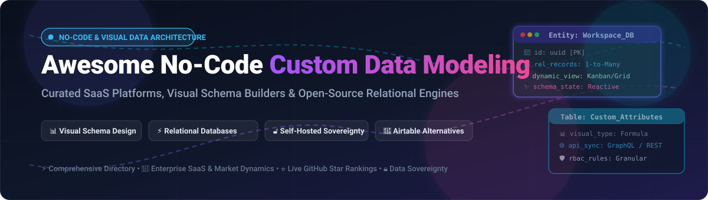

  

# Awesome No-Code Custom Data Modeling 🚀

  
  
  
  
  
  

> 📚 A curated index of top **No-Code Custom Data Modeling Tools**, visual relational schema designers, smart spreadsheet-database hybrids, and self-hosted open-source Airtable alternatives.

---

## 📑 Table of Contents
- [🔍 Sector Overview & Market Dynamics](#-sector-overview--market-dynamics)
- [🏢 SaaS & Hosted Platforms](#-saas--hosted-platforms)
- [🔓 Open-Source GitHub Projects](#-open-source-github-projects)
- [🛠️ Frameworks & Composable Architecture](#️-frameworks--composable-architecture)
- [🌟 Star History](#-star-history)
- [💖 Support & Sponsorship](#-support--sponsorship)
- [🤝 How to Contribute](#-how-to-contribute)
- [⚖️ Disclaimer](#️-disclaimer)

---

## 🔍 Sector Overview & Market Dynamics

The global no-code and low-code development platform market is valued at approximately **$35 billion to $42 billion in 2026** and is projected to surpass **$65 billion by 2030**, registering a robust compound annual growth rate (CAGR) of over 23%. Within this domain, custom data modeling and visual schema design represent the core data backbone empowering operations teams, citizen developers, and agile engineering squads to architect relational schemas without manual SQL coding.

The market structure exhibits **moderate fragmentation with strong bifurcated consolidation**: mega-cap enterprise incumbents (e.g., Salesforce, Smartsheet) dominate broad enterprise workflows, while category-defining challengers (Airtable, Notion, Coda) capture modern knowledge workers. Simultaneously, a vibrant ecosystem of self-hosted open-source engines (Supabase, NocoDB, Directus, Teable, Baserow) has flourished to address escalating demands for data sovereignty, local PostgreSQL ownership, and freedom from vendor lock-in.

---

## 🏢 SaaS & Hosted Platforms

Below is a comparison of premier commercial SaaS platforms for visual custom data modeling, ranked by company size (valuation or market capitalization):

| Platform 🛠️ | Description 📝 | Company Scale / Valuation 💰 | Starting Tier Price 🏷️ | Free Tier Limits 🎁 |
| :--- | :--- | :--- | :--- | :--- |
| **[Salesforce Lightning Object Creator](https://www.salesforce.com/)** | Enterprise-grade no-code custom object, schema, and relationship builder natively wired into CRM workflows and role permissions. | ~$280B Market Cap (NYSE: CRM) | **$25 / user / month** (Starter Suite, billed annually) | 30-day free trial (Full access to Starter Suite features for up to 10 users; no credit card required) |
| **[Smartsheet](https://www.smartsheet.com/)** | Enterprise work and relational project management platform combining grid, Gantt, and automated relational sheet dependencies. | ~$8.4B Valuation (Acquired by Blackstone & Vista) | **$9 / user / month** (Pro Plan, billed annually; max 10 users) | 30-day free trial (Full Pro feature access for up to 50 sheets and automations; no free-forever plan) |
| **[Notion Databases](https://www.notion.so/)** | Flexible, interconnected workspace databases with relational rollups, formula properties, kanban, and bidirectional links. | ~$10.0B Valuation (Private) | **$10 / user / month** (Plus Plan, billed annually) | **Free forever plan**: Unlimited pages & blocks for individuals, up to 10 guest collaborators, 5 MB file upload limit, and 7-day page history |
| **[Airtable](https://airtable.com/)** | Relational spreadsheet-database pioneer featuring visual data modeling, linked tables, interfaces, and synced views. | ~$11.7B Valuation (Private) | **$20 / user / month** (Team Plan, billed annually) | **Free forever plan**: Up to 5 creators/editors, 1,000 records per base, 1 GB attachment storage per base, and up to 100 automation runs/month |
| **[Coda](https://coda.io/)** | All-in-one document and database platform with interconnected structured tables, formula-driven buttons, and workflow packs. | ~$1.4B Valuation (Private) | **$10 / Doc Maker / month** (Pro Plan, billed annually; Editors/Viewers free) | **Free forever plan**: Unlimited un-nested docs, 50 tables/views per doc, 1,000 rows per doc, 10 MB doc size, and up to 35 automation runs/month |
| **[Quickbase](https://www.quickbase.com/)** | Enterprise no-code application builder and complex relational database platform with visual schema and workflow modeling. | ~$1.0B+ Valuation (Welsh, Carson, Anderson & Stowe) | **$35 / user / month** (Team Plan, billed annually; min. 20 users) | 30-day free trial (Full access to build custom business apps, relational workflows, and reports for unlimited test users) |
| **[Kintone](https://www.kintone.com/)** | Visual business application builder with customizable relational databases, dynamic forms, and granular team permissions. | ~$850M Market Cap (Cybozu Inc., TYO: 4776) | **$24 / user / month** (Standard Plan; min. 5 users) | 30-day free trial (Full access for up to 500 apps, 1,000 users, and dynamic workflow rules; no credit card required) |
| **[Caspio](https://www.caspio.com/)** | Cloud database platform for building secure, scalable relational database apps, visual forms, and search interfaces without code. | ~$100M+ Estimated Valuation | **$50 / month** (Starter Plan, includes unlimited users) | 14-day free trial (Access to all standard database features, visual data pages, and up to 50,000 records) |
| **[Knack](https://www.knack.com/)** | Online database builder featuring relational schema modeling, custom queries, user roles, and embeddable frontends. | ~$50M+ Estimated Valuation | **$39 / month** (Starter Plan, billed annually) | 14-day free trial (Access to build relational apps with up to 3 apps, 20,000 records, and 2 GB storage) |
| **[Baserow Cloud](https://baserow.io/)** | Cloud-hosted open-core database platform providing flexible table linking, real-time collaboration, and developer-friendly REST APIs. | ~$15M - $25M Estimated Valuation (Seed/Series A) | **$5 / user / month** (Premium Plan, billed annually) | **Free forever plan**: Unlimited databases and tables, up to 3,000 rows per database workspace, and 2 GB storage |

---

## 🔓 Open-Source GitHub Projects

Explore the top self-hostable and open-source data modeling tools, sorted by live GitHub star popularity:

| Project & Repository 📦 | GitHub_Stars ⭐ | License 📜 | Highlights & Architecture 💡 |
| :--- | :--- | :--- | :--- |
| **[Supabase](https://github.com/supabase/supabase)** |  | Apache-2.0 | Complete open-source Firebase alternative featuring full PostgreSQL visual table editor, real-time subscriptions, SQL schema designer, auth, and auto-generated REST/GraphQL APIs. |
| **[NocoDB](https://github.com/nocodb/nocodb)** |  | AGPL-3.0 | Leading open-source Airtable alternative. Connects to any existing relational database (PostgreSQL, MySQL, SQLite, SQL Server) and turns it into a smart spreadsheet with Grid, Gallery, Kanban, and Form views. |
| **[ToolJet](https://github.com/ToolJet/ToolJet)** |  | AGPL-3.0 | Extensible low-code application builder featuring ToolJet Database—a visual relational table and schema builder with direct API triggers, custom components, and 50+ integrations. |
| **[Appsmith](https://github.com/appsmithorg/appsmith)** |  | Apache-2.0 | Powerful platform to build internal data tools, admin dashboards, and relational schema management interfaces. Integrates with 25+ databases with dynamic JS bindings. |
| **[Directus](https://github.com/directus/directus)** |  | BSL 1.1 / Apache-2.0 | Instant headless data studio and visual API generator. Wraps any existing SQL schema with an intuitive no-code data studio, granular field-level permissions, and real-time endpoints. |
| **[Budibase](https://github.com/Budibase/budibase)** |  | GPL-3.0 | All-in-one low-code engine for operational applications with built-in relational database, visual table schemas, custom relationships, form generators, and automations. |
| **[NocoBase](https://github.com/nocobase/nocobase)** |  | AGPL-3.0 | Scalable AI + no-code data platform built on top of relational database architectures. Supports data blocks, deep field associations, multi-data-source bindings, and micro-kernel plugin architecture. |
| **[Teable](https://github.com/teableio/teable)** |  | AGPL-3.0 | High-performance visual Airtable alternative natively powered by PostgreSQL. Capable of handling millions of rows with sub-second response times, spreadsheet-like formulas, and real-time collaboration. |
| **[Grist](https://github.com/gristlabs/grist-core)** |  | Apache-2.0 | Relational spreadsheet platform that bridges spreadsheets and full relational databases. Supports Python formulas, cross-table foreign key references, access control rules, and self-hosting. |
| **[API Platform](https://github.com/api-platform/api-platform)** |  | MIT | Hypermedia and GraphQL framework that scaffolds entire REST/GraphQL backends and schema definitions directly from custom data models with automatic OpenAPI specs. |
| **[Rowy](https://github.com/rowyio/rowy)** |  | Apache-2.0 | Open-source low-code platform for managing Firestore/Firebase databases with an intuitive spreadsheet-style interface, custom UI extensions, and serverless Cloud Functions workflows. |
| **[Baserow](https://github.com/baserow/baserow)** |  | MIT | Modern open-source visual database and app builder. Features visual table designers, relational links, lookup/rollup fields, AI agent integrations, and compliance-ready self-hosting (GDPR, HIPAA, SOC 2). |
| **[Mathesar](https://github.com/mathesar-foundation/mathesar)** |  | GPL-3.0 | Clean, intuitive spreadsheet GUI built specifically for PostgreSQL. Allows technical and non-technical teammates to design relational schemas, constraints, and tables directly on native Postgres. |
| **[Saltcorn](https://github.com/saltcorn/saltcorn)** |  | MIT | Completely free and open-source no-code database web application builder with visual table/relationship designer, rich form builders, page layouts, and mobile app exports. |
| **[Sovrium](https://github.com/sovrium/sovrium)** |  | MIT | Declarative configuration-driven web application platform. A single file scaffolds custom database entities, REST endpoints, and responsive views with 49 rich field types. |
| **[pgkiln](https://github.com/pgkiln/pgkiln)** |  | MIT | Low-code, SQL-driven application and schema builder for PostgreSQL inspired by Oracle APEX. Stores schema metadata directly inside Postgres tables and provides MCP server support. |
| **[d9 (Datos Online)](https://github.com/Datos-Online/d9)** |  | GPL-3.0 | Open data platform designed to democratize SQL database access, visual schema navigation, and instant REST/GraphQL querying without creating data silo locks. |

---

## 🛠️ Frameworks & Composable Architecture

For teams engineering bespoke internal platforms and custom enterprise stacks, consider composable patterns:
- **Relational Data Layer**: Use **NocoDB**, **Teable**, or **Baserow** for front-facing tabular schema creation and citizen-developer workflows.
- **Headless API & Permission Engine**: Layer **Directus** or **Supabase** directly over your SQL databases to handle automatic CRUD, granular RBAC, and webhooks.
- **Visual Application Frontends**: Combine **Appsmith**, **ToolJet**, or **Budibase** to design operational dashboards and interactive multi-step data pipelines.
- **Analytics & Reporting**: Connect **Metabase** or **Apache Superset** directly to the underlying PostgreSQL/MySQL database for real-time reporting without impacting transactional throughput.

---

## 🌟 Star History

---

## 💖 Support & Sponsorship

Thank you so much for exploring and using this repository! If this curated guide helps you architect schemas, select the right no-code database stack, or build faster:

- ⭐ **Star this repository** to help others discover it!
- 🍴 **Fork and share** it with your fellow developers, builders, and community.
- ☕ **Buy me a coffee**: If you'd like to support ongoing updates and maintenance, consider sponsoring via the [GitHub Sponsors Dashboard](https://github.com/sponsors/ishandutta2007):

  
  &nbsp;
  

Your support and contributions keep this directory independent, accurate, and actively maintained!

---

## 🤝 How to Contribute

Contributions are welcome and highly appreciated!
1. 🍴 Fork the repository.
2. 🌿 Create your feature branch (`git checkout -b feature/new-tool`).
3. 📝 Add your entry to `README.md` following the established table structure.
4. 💡 Make sure to include official documentation links, exact pricing/limits, and open-source licenses.
5. 🚀 Submit a pull request with a descriptive summary of your addition.

---

## ⚖️ Disclaimer

- This repository is a community-curated directory intended for research, architectural planning, and educational purposes.
- All product names, logos, and brands are property of their respective owners.
- When deploying self-hosted solutions for enterprise workloads, ensure compliance with applicable regulations (e.g., GDPR, HIPAA, SOC 2, CCPA) and implement standard database backup and network security best practices.

---

  Maintained with ❤️ by <a href="https://github.com/ishandutta2007">Ishan Dutta</a> and the global open-source community.

